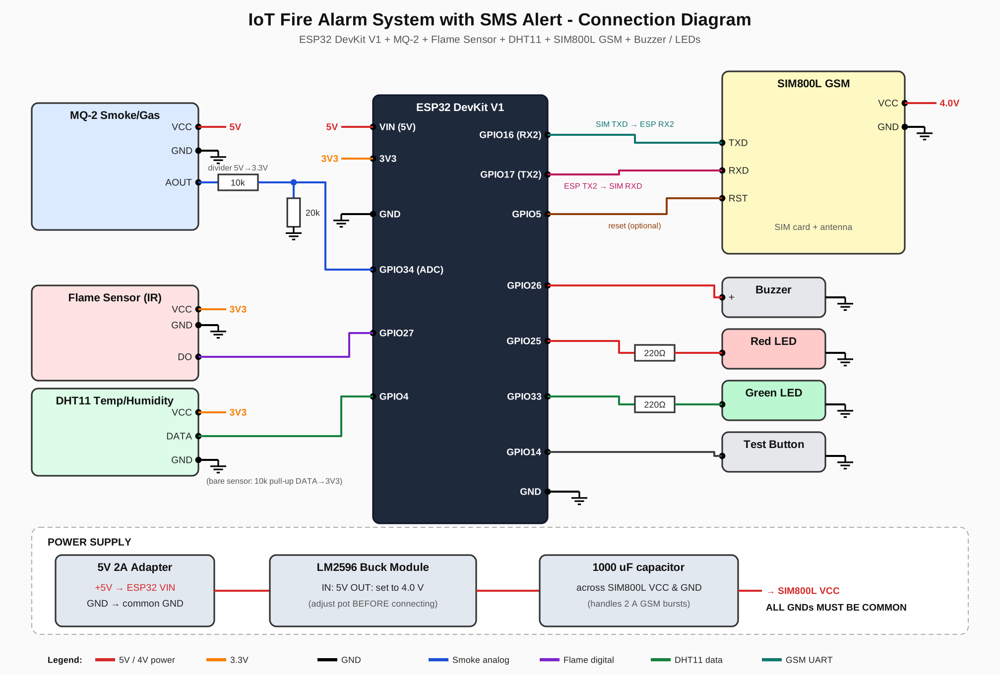
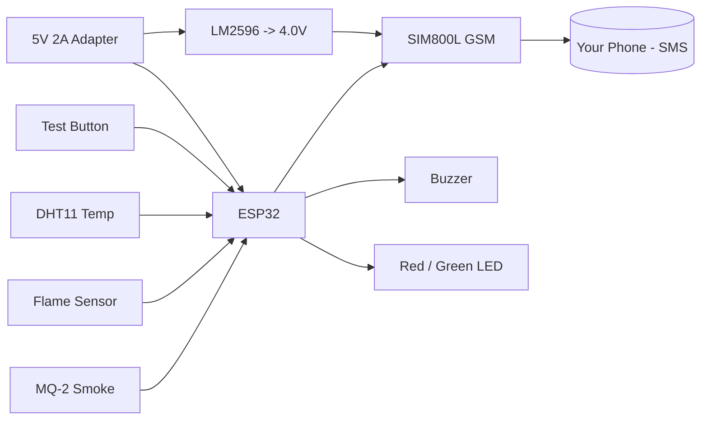
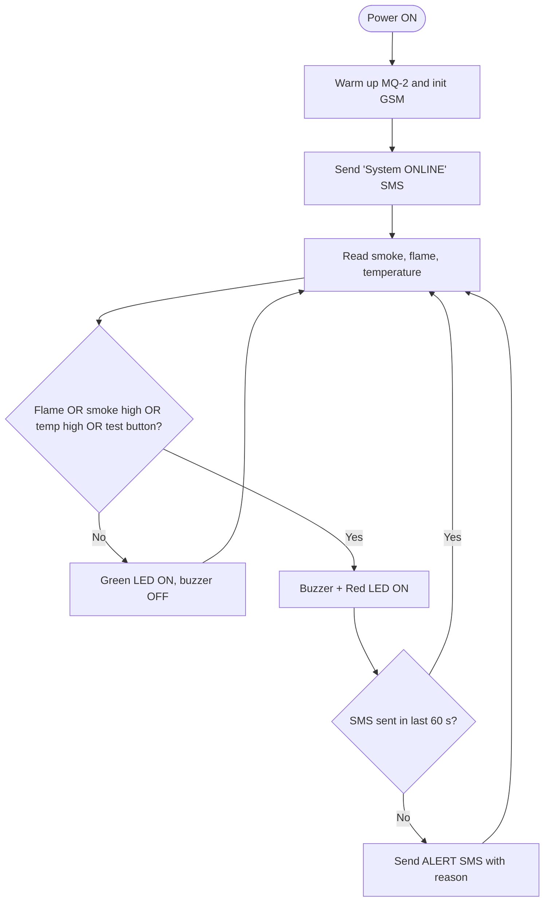

# 🔥 IoT Fire Alarm System with SMS Alert

An IoT-based fire detection system built on the **ESP32**. It continuously monitors **smoke/gas**, **flame** and **temperature**. When danger is detected it sounds a buzzer, lights a red LED and sends an **SMS alert** to your mobile phone through a **SIM800L GSM module** - no Wi-Fi or internet needed.

---

## 📑 Table of Contents
1. [Features](#-features)
2. [Components Required](#-components-required)
3. [Circuit Diagram](#-circuit-diagram)
4. [Pin Connections](#-pin-connections)
5. [Power Supply (Important)](#-power-supply-important)
6. [Working Principle](#-working-principle)
7. [Software Setup](#-software-setup)
8. [Calibration](#-calibration)
9. [Testing](#-testing)
10. [Sample SMS](#-sample-sms)
11. [Troubleshooting](#-troubleshooting)
12. [Future Improvements](#-future-improvements)
13. [Safety Notes](#-safety-notes)
14. [Project Structure](#-project-structure)

---

## ✨ Features
- Triple detection: smoke/gas (MQ-2), flame (IR sensor) and temperature (DHT11)
- Instant SMS alert with the reason for the alarm (flame / smoke / temperature)
- Local alarm: buzzer + red LED; green LED shows "system normal"
- SMS cooldown (60 s) to avoid spamming; automatic "All clear" SMS
- Push button to **test** the alarm and SMS any time
- Works anywhere with 2G coverage - independent of Wi-Fi

---

## 🧰 Components Required

| # | Component | Qty | Notes |
|---|-----------|-----|-------|
| 1 | ESP32 DevKit V1 (30-pin) | 1 | Main controller |
| 2 | SIM800L GSM module | 1 | Needs a **2G-enabled** SIM with SMS balance |
| 3 | MQ-2 smoke/gas sensor module | 1 | Analog output (AO) used |
| 4 | IR flame sensor module | 1 | Digital output (DO) used |
| 5 | DHT11 temperature sensor | 1 | Module or bare sensor |
| 6 | Active buzzer (5 V) | 1 | |
| 7 | LEDs - red, green | 1 each | |
| 8 | Resistors 220 Ω | 2 | LED current limiting |
| 9 | Resistors 10 kΩ and 20 kΩ | 1 each | Voltage divider for MQ-2 AO |
| 10 | LM2596 buck converter | 1 | Powers SIM800L at 4.0 V |
| 11 | Capacitor 1000 µF / 10 V | 1 | Across SIM800L supply |
| 12 | Push button | 1 | Test button |
| 13 | 5 V 2 A power adapter | 1 | Whole system |
| 14 | GSM antenna, SIM card, breadboard, jumper wires | - | |

---

## 🔌 Circuit Diagram



> The ESP32 block is drawn schematically and pins are labeled by **GPIO number**. Match them with the labels printed on your board.

### Block Diagram


---

## 🔗 Pin Connections

### MQ-2 Smoke Sensor
| MQ-2 Pin | Connects To |
|----------|-------------|
| VCC | 5 V (ESP32 VIN) |
| GND | GND |
| AO | 10 kΩ → node → **GPIO34**; node → 20 kΩ → GND |

> MQ-2 outputs up to 5 V but the ESP32 ADC tolerates only 3.3 V, so the 10k/20k divider (output ≈ 2/3) is **required**.

### Flame Sensor
| Pin | Connects To |
|-----|-------------|
| VCC | 3V3 |
| GND | GND |
| DO | **GPIO27** (LOW = flame detected) |

### DHT11
| Pin | Connects To |
|-----|-------------|
| VCC | 3V3 |
| DATA | **GPIO4** (add 10 kΩ pull-up to 3V3 if using a bare sensor) |
| GND | GND |

### SIM800L GSM Module
| SIM800L Pin | Connects To |
|-------------|-------------|
| VCC | **4.0 V from LM2596** (NOT from ESP32 pins) |
| GND | Common GND |
| TXD | **GPIO16** (ESP32 RX2) |
| RXD | **GPIO17** (ESP32 TX2) |
| RST | **GPIO5** (optional reset) |

### Outputs and Input
| Device | ESP32 Pin | Other Side |
|--------|-----------|------------|
| Buzzer (+) | GPIO26 | GND |
| Red LED (anode) | GPIO25 via 220 Ω | cathode → GND |
| Green LED (anode) | GPIO33 via 220 Ω | cathode → GND |
| Test button | GPIO14 | other leg → GND (internal pull-up used) |

### Summary Table
| GPIO | Function |
|------|----------|
| 34 | MQ-2 analog input |
| 27 | Flame sensor input |
| 4 | DHT11 data |
| 16 / 17 | UART2 RX / TX to SIM800L |
| 5 | SIM800L reset |
| 26 | Buzzer |
| 25 / 33 | Red / Green LED |
| 14 | Test button |

---

## ⚡ Power Supply (Important)

The SIM800L is the most common reason this project fails:

1. SIM800L needs **3.7-4.2 V** and draws up to **2 A** in short bursts when transmitting. The ESP32's 3.3 V pin **cannot** power it.
2. Set the LM2596 output to **4.0 V with a multimeter first**, then connect the SIM800L.
3. Place the **1000 µF capacitor** directly across the SIM800L VCC and GND.
4. **Connect all grounds together** (adapter, ESP32, sensors, SIM800L, buck module).
5. Use a good 5 V **2 A** adapter and short, thick wires for the SIM800L supply.
6. A 3.3 V ESP32 UART is acceptable for the SIM800L; no level shifter is needed.

---

## ⚙️ Working Principle



1. The ESP32 reads the three sensors every 0.5 s.
2. If **any** reading crosses its threshold (or the test button is pressed), the alarm turns on.
3. The ESP32 talks to the SIM800L with **AT commands** (`AT+CMGF=1`, `AT+CMGS`) to send a text message.
4. When conditions stay normal for 15 s, the alarm turns off and an **"All clear"** SMS is sent.

---

## 💻 Software Setup

1. Install the **Arduino IDE** (2.x).
2. Add ESP32 support: *File → Preferences → Additional Boards Manager URLs* → add  
   `https://raw.githubusercontent.com/espressif/arduino-esp32/gh-pages/package_esp32_index.json`  
   then *Tools → Board → Boards Manager* → install **esp32 by Espressif**.
3. Install libraries via *Library Manager*: **DHT sensor library** (Adafruit) and **Adafruit Unified Sensor**.
4. Open `fire_alarm_esp32.ino` and edit:
   ```cpp
   const char PHONE_NUMBER[] = "+91XXXXXXXXXX";   // your number with country code
   ```
5. Select board **ESP32 Dev Module**, choose the COM port, and click **Upload**.
   (If upload fails, hold the **BOOT** button while it says "Connecting...".)
6. Open the Serial Monitor at **115200 baud** to view readings.

---

## 🎚️ Calibration

- MQ-2 needs about **30 s warm-up** each power-on, and **24-48 h burn-in** the very first time for stable readings.
- Open the Serial Monitor and note the `Smoke:` value in clean air (e.g. 600-900).
- Light an incense stick / match near the sensor and note the rise.
- Set `SMOKE_THRESHOLD` between the two values.
- Turn the blue potentiometer on the flame sensor until its LED switches only when a flame is present.
- Adjust `TEMP_THRESHOLD` (default 50 °C) as required.

---

## 🧪 Testing

| Test | Expected Result |
|------|-----------------|
| Power on | Both LEDs on during warm-up, then green LED on, "ONLINE" SMS received |
| Press test button | Buzzer + red LED on, "TEST:" SMS received |
| Candle/lighter near flame sensor (safe distance) | Alarm + "Flame detected" SMS |
| Smoke from incense near MQ-2 | Alarm + "High smoke/gas" SMS |
| Remove hazard | After ~15 s alarm stops, "All clear" SMS |

---

## 📩 Sample SMS

```
FIRE ALERT! Flame detected. High smoke/gas (2450). Temp 52.0C. Check immediately!
```

---

## 🛠️ Troubleshooting

| Problem | Likely Cause / Fix |
|---------|-------------------|
| SIM800L keeps restarting / no response | Weak power - check 4.0 V, capacitor, 2 A supply, common GND |
| `AT` gets no "OK" | Swap TX/RX wires; baud 9600; check GPIO16/17 |
| Network LED blinks fast (1 s) | Not registered yet - wait; check antenna and SIM |
| Slow blink (3 s) | Registered to network - good |
| SMS not delivered | No balance, SIM is not 2G-compatible, or wrong number format (use +country code) |
| Smoke value always 4095 | Missing voltage divider or wrong pin (use GPIO34) |
| False alarms | Raise `SMOKE_THRESHOLD`, allow MQ-2 to warm up |
| DHT11 shows `nan` | Check wiring/pull-up resistor |
| Upload fails | Hold BOOT button while uploading; check USB cable/driver |

> **Note:** SIM800L supports only **2G (GSM)**. Check that your carrier still supports 2G in your area.

---

## 🚀 Future Improvements
- Upload data to a cloud dashboard (ThingSpeak / Blynk / MQTT) over Wi-Fi
- Automatic **voice call** with `ATD<number>;`
- Multiple phone numbers
- Relay to trigger a water pump or sprinkler
- LCD/OLED display for live readings
- Battery backup (18650 Li-ion) for power failures

---

## ⚠️ Safety Notes
- This is a **prototype / academic project** and **not a certified fire safety device**. Do not rely on it as your only protection.
- Test flames only in a safe, controlled environment.
- Keep Li-ion batteries away from heat if you add a battery backup.

---

## 📁 Project Structure
```
fire-alarm-iot/
├── README.md               # this file
├── circuit_diagram.png     # connection diagram
├── circuit_diagram.svg     # editable vector version
└── fire_alarm_esp32.ino    # ESP32 Arduino code
```

## 📜 License
Free to use for educational purposes (MIT License).
